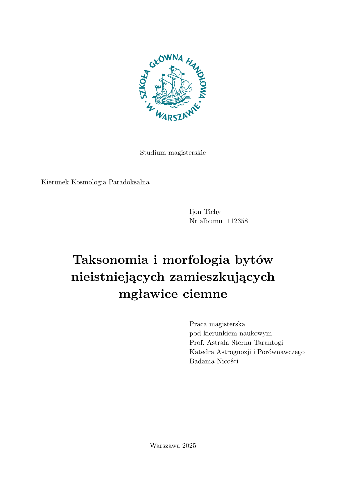

# sgh-thesis

A diploma thesis template (bachelor's and master's) compliant with the editorial
requirements of the SGH Warsaw School of Economics (Szkoła Główna Handlowa
w Warszawie). The template is bilingual — it supports Polish and English.

The default font used for typesetting theses is New Computer Modern, which ships
with every Typst installation, so no additional configuration is required to use
the template.

The full manual, a complete example thesis, and the matching SGH presentation
template are available in the project repository:
<https://github.com/piotr-m-kuszewski/Szablony_Typst_SGH>.



## Installation

The package has not been published on Typst Universe yet. Once it is, the
`#import "@preview/sgh-thesis:0.2.0": *` line shown below will download it
automatically. Until then, install it manually in one of two ways.

**Copy the template file into your project.** Copy `sgh-thesis/sgh-thesis.typ`
from the repository into the folder that holds your document and import it by file
name: `#import "sgh-thesis.typ": *`. This also works on the Typst web app, where
you upload the file to the project.

**Install it as a local package.** Copy the whole `sgh-thesis/0.2.0` folder from
the repository so that its `typst.toml` ends up in

- macOS: `~/Library/Application Support/typst/packages/local/sgh-thesis/0.2.0/`
- Windows: `%APPDATA%\typst\packages\local\sgh-thesis\0.2.0\`

and import it with `#import "@local/sgh-thesis:0.2.0": *`. The Typst web app does
not see folders on your computer, but Typst Pro users can publish a project holding
the package files as a private package, as described in
[Private Packages](https://typst.app/docs/web-app/private-packages/), and import it
with the same `@local` line.

## Usage

```typst
#import "@preview/sgh-thesis:0.2.0": *

#show: sgh.with(
  author: "Ijon Tichy",
  student-id: "112358",
  title: "Taksonomia i morfologia bytów nieistniejących zamieszkujących mgławice ciemne",
  advisor: "prof. Astrala Sternu Tarantogi", // inflected for the phrase "pod kierunkiem naukowym..."
  advisor-department: "Katedra Astrognozji i Porównawczego Badania Nicości",
  year: "2025",
  studies: "mgr",       // "mgr" (master's) or "lic" (bachelor's)
  program: "Kosmologia Paradoksalna",
  language: "pl",       // "pl" or "en"
  advisor-comments: false, // true: draft with the supervisor's comments in the margin
)

#sgh-summary[
  Abstract text.
]

#table-of-contents()

= Introduction

Body of the thesis...

#list-of-sources(read("sources.bib", encoding: none))
#list-of-figures()
#list-of-tables()
```

## Generating the bibliography

There are two ways to produce the bibliography:

1. **`list-of-sources`** (template procedure — adds a page break, uses the Harvard
   style by default and titles the list "Bibliografia", or "Bibliography" in an
   English thesis, as the SGH standard requires). Because the call to `bibliography` lives *inside* the package,
   a plain path string would be resolved relative to the package, not your document.
   Read the file with `read(..., encoding: none)` in your own document and pass the
   resulting bytes:

   ```typst
   #list-of-sources(read("sources.bib", encoding: none))
   // optionally choose a style:
   #list-of-sources(read("sources.bib", encoding: none), styl: "ieee")
   ```

2. **Built-in `bibliography`** — called directly in your document, so a path string
   works as usual and you get full control over title and style:

   ```typst
   #pagebreak()
   #bibliography("sources.bib", title: [Bibliografia], style: "harvard-cite-them-right")
   ```

## Supervisor's comments

The supervisor can write comments directly in the source of the thesis, and the
author can reply. Consecutive content blocks are the turns of the conversation:
supervisor, author, supervisor, …

```typst
The results were clear: #sgh-comment[Clear to whom?][I added the values.]the
instruments showed negative readings.

#sgh-comment(resolved: true)[Please add a conclusion.][Added.]Paragraph…
```

The comments stay in the source. `advisor-comments: true` produces a draft: the
page is widened to 280 mm and the comments appear in the right margin. The default
`false` produces the final version, in which the comments leave no trace. The
command line overrides the parameter without editing the file:
`typst compile --input advisor-comments=true thesis.typ` (or `=false`).

A comment placed before the first word of a paragraph is aligned with the top of
the paragraph, one placed right after its last word with the bottom, and one
inside a paragraph with its line, linked to a marker in the text. Inside a
paragraph, put the comment after the space, right before the word it refers to.
`at: "start" | "inside" | "end"` forces the alignment; `resolved: true` shrinks the
comment to one struck-through line. Comments also work in table cells; they are not
supported in headings, captions, footnotes or repeated table headers.

## Available procedures

- `sgh(...)` — the main template procedure; generates the title page and configures
  document formatting (used with `#show: sgh.with(...)`).
- `sgh-summary[...]` — the thesis abstract.
- `table-of-contents()` — table of contents.
- `list-of-figures()` — list of figures.
- `list-of-tables()` — list of tables.
- `list-of-sources(plik, styl: "harvard-cite-them-right")` — bibliography; `plik`
  must be the file contents read with `read(..., encoding: none)` (bytes), not a path.
- `sgh-figure(caption:, source:, placement:, body)` — a figure with a caption and
  source; included in the list of figures.
- `sgh-table(caption:, source:, placement:, body)` — a table with a caption and
  source; included in the list of tables.
- `sgh-stripped-tables` — formats tables with alternating shaded rows
  (used with `#show: sgh-stripped-tables`).
- `sgh-comment(resolved: false, at: auto, ..bodies)` — a supervisor's comment with
  the author's replies; visible only when `advisor-comments` is on.

## License

MIT — see the [LICENSE](LICENSE) file.
